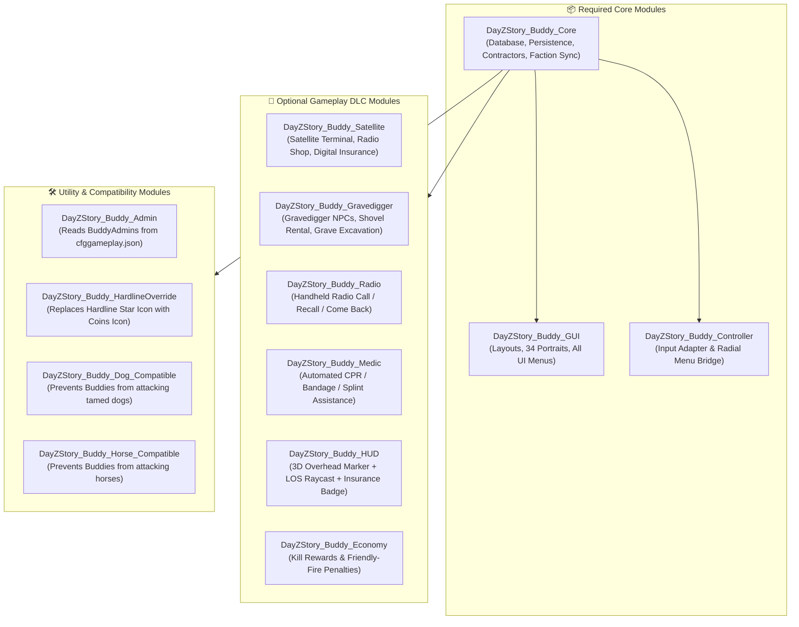

# Chapter 1: Architecture & Installation Guide

> **[⬅️ Back to English Wiki Home](./README.md)** | **[➡️ Chapter 2: Core `BuddySettings.json` Reference](./02-Core-BuddySettings.md)**

---

## 1. Modular Enterprise Architecture Overview

**`DayZStory_BuddySystem`** is built on a modular architecture consisting of **12 PBO packages**: **3 Required Core PBOs** and **9 Optional DLC / Utility PBOs** that server administrators can mix and match to fit their server's playstyle.



---

## 2. All 12 PBO Modules Explained

| # | PBO Filename | Requirement | Config File Path (`$profile:DayZStory/AiBuddy/`) | Purpose & Responsibilities |
| :-: | :--- | :---: | :--- | :--- |
| **1** | `DayZStory_Buddy_Core.pbo` | **Required** | `BuddySettings.json` & `DLC/Contractors/Setting.json` | Core persistence engine, per-SteamID inventory save files, Contractor NPC spawning, automatic Owner-to-Buddy Faction synchronization, and death/recovery state management. |
| **2** | `DayZStory_Buddy_GUI.pbo` | **Required** | *(Uses Core & Satellite configs)* | Centralized graphic assets (34 buddy `.paa` portraits, `.edds` icons, `.layout` files) and all scripted UI menus (`BuddyMenu`, `ManageBuddyMenu`, `BuddyRecoveryTerminalMenu`, `BuddyStatusMenu`, `BuddyRenameMenu`, `BuddyHireWarningMenu`). |
| **3** | `DayZStory_Buddy_Controller.pbo` | **Required** | `DLC/Controller/Setting.json` | Input adapter and Radial Menu bridge (automatically detects `DayZStory_RadialMenu` or falls back to Expansion's `eAICommandMenu`). |
| **4** | `DayZStory_Buddy_Satellite.pbo` | Optional DLC | `DLC/Satellite/Setting.json` | Spawns Emergency Satellite Terminals (`DZS_SatelliteTerminal`), provides Radio Frequency Pairing, Satellite Buddy Recall, the 3D Radio Equipment Shop, and Digital Insurance purchasing/claiming. |
| **5** | `DayZStory_Buddy_Gravedigger.pbo` | Optional DLC | `DLC/Gravedigger/Setting.json` | Spawns Cemetery Gravedigger NPCs (`eAIFactionGravediggers`), borrowed shovels (`DZS_GravediggerShovel`), companion graves (`DZS_BuddyGrave`), DayZ Editor `.json` cemetery scenes, and grave excavation to recover gear in a private `eAI_SupplyCrate`. |
| **6** | `DayZStory_Buddy_Radio.pbo` | Optional DLC | `DLC/Radio/Setting.json` | Adds handheld radio (`TransmitterBase`) actions to `Call/Recall` your companion, teleport separated companions back (`Call AI Back`), and open the companion management menu. |
| **7** | `DayZStory_Buddy_Medic.pbo` | Optional DLC | `DLC/Medic/Setting.json` | Realtime AI Field Medic behavior: when the owner falls unconscious, bleeds, or breaks a leg, the companion rushes over and performs actual CPR / Epinephrine injection, bandaging, or splinting animations. |
| **8** | `DayZStory_Buddy_HUD.pbo` | Optional DLC | `DLC/HUD/Setting.json` | Renders a 3D overhead marker above your companion with physics Line-of-Sight (LOS) raycasting (hides markers behind walls/terrain) and displays the Digital Insurance policy count badge on the bottom-right HUD. |
| **9** | `DayZStory_Buddy_Economy.pbo` | Optional DLC | `DLC/Economy/Setting.json` | Grants currency/reputation rewards when your companion kills zombies, hunts wildlife, or eliminates hostile AI/players, and deducts penalties for friendly fire/betrayal. |
| **10** | `DayZStory_Buddy_Admin.pbo` | Optional Utility | `cfggameplay.json` (`BuddyAdmins`) | Allows server admins to define buddy system administrator SteamIDs inside the mission's `cfggameplay.json` under `PlayerData.BuddyAdmins`. |
| **11** | `DayZStory_Buddy_HardlineOverride.pbo` | Optional UI | *(No JSON)* | Replaces the default DayZ Expansion Hardline star icon on the bottom-right HUD with a custom coins icon (`coins.edds`). |
| **12** | `DayZStory_Buddy_Dog_Compatible.pbo` & `Horse_Compatible.pbo` | Optional Compatibility | *(No JSON)* | Prevents AI companions from treating tamed dogs (`DayZ_Dog`) or horses as hostile wildlife targets. |

---

## 3. Required External Dependencies

Ensure the following mods are loaded before `DayZStory_BuddySystem`:

1. **Community Framework (`CF`)** & **Dabs Framework (`DZM_DabsFramework`)**
2. **DayZ Expansion** (Required modules):
   - `DayZExpansion_Core`
   - `DayZExpansion_AI`
   - `DayZExpansion_Hardline`
   - `DayZExpansion_Groups`
   - *(Recommended)* `DayZExpansion_Navigation` (for 3D markers)
3. **DayZStory Core Frameworks**:
   - `DZS_LogFramework`
   - `DayZStory_Notifications`
4. **Optional Supported Integrations**:
   - `DayZStory_PlayerFaction`: Automatically syncs the owner's faction from `$profile:DayZStory/PlayerFaction/PlayerData/<SteamID>.json` to their hired companion.
   - `DayZStory_eWallet`: Enables `EconomyMode = 1` (eWallet Coins).
   - `DayZExpansion_Market`: Enables `EconomyMode = 2` (Expansion ATM Bank Balance).
   - `DayZStory_RadialMenu`: Enables custom DayZStory radial command wheel.

---

## 4. Server `$profile` Directory Structure

On first server boot, all configuration files are automatically generated in your server profile directory:

```text
$profile:\DayZStory\AiBuddy\
 ├── BuddySettings.json                      <-- [Core] Master settings, primary currency, death mode & 34-buddy roster
 ├── BuddyData\                              <-- [Player Saves] Per-SteamID64 companion & inventory save files
 │    └── 76561198242071384.json
 ├── InsuranceData\                          <-- [Insurance DB] Per-SteamID64 active digital insurance policy count
 │    └── 76561198242071384.json
 ├── Logs\                                   <-- [Audit Logs] Detailed recruitment, death, claim, and medic logs
 └── DLC\
      ├── Contractors\
      │    └── Setting.json                  <-- Contractor NPC positions, orientations, loadouts, and EmoteIDs
      ├── Satellite\
      │    └── Setting.json                  <-- Satellite Terminal spawns, insurance/recovery fees & RadioShop config
      ├── Gravedigger\
      │    ├── Setting.json                  <-- Gravedigger NPC spawns, manual graves, shovel fee & digging time
      │    └── Graves\                       <-- Folder for DayZ Editor (.json) cemetery scene files
      ├── Radio\
      │    └── Setting.json                  <-- Handheld radio recall rules, mandatory pairing & allowed radio classes
      ├── Medic\
      │    └── Setting.json                  <-- Automated CPR, bandage & splint rules, distances & cooldowns
      ├── HUD\
      │    └── Setting.json                  <-- 3D Marker visibility, LOS raycast toggles & HUD badge position
      ├── Economy\
      │    └── Setting.json                  <-- Kill rewards (zombies/animals/AI) & betrayal penalties
      └── Controller\
           └── Setting.json                  <-- Radial menu mode selection (Auto / DayZStory / Expansion)
```
