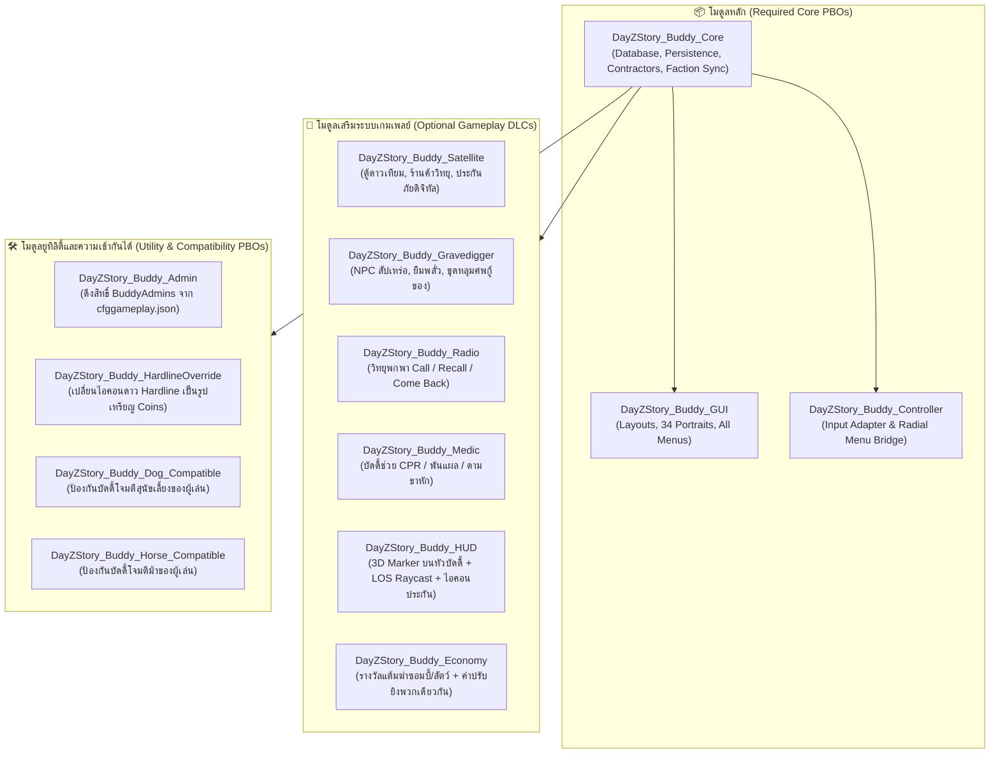

# บทที่ 1: สถาปัตยกรรมระบบและการติดตั้ง (Architecture & Installation Guide)

> **[⬅️ กลับสารบัญภาษาไทย](./README.md)** | **[➡️ บทที่ 2: คอนฟิกหลัก BuddySettings.json](./02-Core-BuddySettings.md)**

---

## 1. ภาพรวมสถาปัตยกรรม (Modular Enterprise Architecture)

**`DayZStory_BuddySystem`** ออกแบบโดยแยกการทำงานออกเป็น **12 โมดูล (PBO)** แบ่งเป็น **3 โมดูลหลัก (Core Modules)** ที่จำเป็นต้องติดตั้งเสมอ และ **9 โมดูลเสริมอิสระ (Optional DLCs)** ที่แอดมินสามารถเลือกใส่หรือถอดออกได้ตามสไตล์ของเซิร์ฟเวอร์



---

## 2. ตารางสรุปหน้าที่ของทั้ง 12 PBO

| ลำดับ | ชื่อไฟล์ PBO | ประเภท | ไฟล์ตั้งค่า JSON | หน้าที่การทำงาน |
| :---: | :--- | :---: | :--- | :--- |
| **1** | `DayZStory_Buddy_Core.pbo` | **จำเป็น (Required)** | `BuddySettings.json` & `DLC/Contractors/Setting.json` | ระบบฐานข้อมูลหลัก, เซฟข้อมูลบัดดี้และไอเทมราย SteamID, สปอน NPC นายหน้าว่าจ้าง (Contractors), ซิงค์ Faction ตามผู้เล่น และจัดการระบบตาย/กู้คืน |
| **2** | `DayZStory_Buddy_GUI.pbo` | **จำเป็น (Required)** | *(ใช้ค่าจาก Core & Satellite)* | รวมไฟล์กราฟิก รูปโปรไฟล์บัดดี้ 34 ตัวละคร (`.paa`), ไอคอน (`.edds`), และหน้าต่าง UI ทั้งหมด (`BuddyMenu`, `ManageBuddyMenu`, `BuddyRecoveryTerminalMenu`, `BuddyStatusMenu`, `BuddyRenameMenu`, `BuddyHireWarningMenu`) |
| **3** | `DayZStory_Buddy_Controller.pbo` | **จำเป็น (Required)** | `DLC/Controller/Setting.json` | ตัวกลางควบคุมปุ่มคำสั่งด่วนและเชื่อมโยงวงล้อคำสั่ง (สลับอัตโนมัติระหว่าง `DayZStory_RadialMenu` และ `eAICommandMenu` ของ Expansion) |
| **4** | `DayZStory_Buddy_Satellite.pbo` | เสริม (Optional DLC) | `DLC/Satellite/Setting.json` | สปอนตู้ดาวเทียมฉุกเฉิน (`DZS_SatelliteTerminal`), ระบบจูนคลื่นวิทยุ (Pair Radio), เรียกบัดดี้ผ่านดาวเทียม (Satellite Recall), ร้านค้าซื้อวิทยุ (Radio Equipment Shop) และระบบซื้อ/เคลมประกันภัยดิจิทัล |
| **5** | `DayZStory_Buddy_Gravedigger.pbo` | เสริม (Optional DLC) | `DLC/Gravedigger/Setting.json` | สปอน NPC สัปเหร่อ (`eAIFactionGravediggers`), ระบบเช่ายืมพลั่ว (`DZS_GravediggerShovel`), หลุมศพบัดดี้ (`DZS_BuddyGrave`) และการขุดหลุมศพเพื่อกู้คืนสัมภาระบัดดี้เป็นกล่อง `eAI_SupplyCrate` |
| **6** | `DayZStory_Buddy_Radio.pbo` | เสริม (Optional DLC) | `DLC/Radio/Setting.json` | เพิ่มคำสั่งบนวิทยุสื่อสารพกพา (`TransmitterBase`) สำหรับกดเรียกบัดดี้ (`Call/Recall`), เรียกบัดดี้ที่หลงทางให้วาปกลับมาหา (`Call AI Back`) และเปิดเมนูจัดการบัดดี้ |
| **7** | `DayZStory_Buddy_Medic.pbo` | เสริม (Optional DLC) | `DLC/Medic/Setting.json` | ระบบ AI แพทย์สนามอัตโนมัติ: เมื่อผู้เล่นสลบ (Unconscious), เลือดไหล หรือขาหัก บัดดี้จะวิ่งเข้ามาทำท่าปั๊มหัวใจ (CPR) / ฉีด Epinephrine, พันแผล หรือดามเฝือกให้แบบ Realtime |
| **8** | `DayZStory_Buddy_HUD.pbo` | เสริม (Optional DLC) | `DLC/HUD/Setting.json` | แสดง 3D Marker ชื่อและระยะทางบนหัวบัดดี้ (พร้อมระบบ Raycast เช็คสิ่งกีดขวางสายตา LOS ไม่ให้มองทะลุกำแพง) และแสดงไอคอนจำนวนกรมธรรม์ประกันภัยที่มุมขวาล่างของจอ |
| **9** | `DayZStory_Buddy_Economy.pbo` | เสริม (Optional DLC) | `DLC/Economy/Setting.json` | แจกแต้มเมื่อบัดดี้ช่วยฆ่าซอมบี้, ล่าสัตว์ หรือสังหารศัตรู และหักแต้มค่าปรับเมื่อผู้เล่นยิงบัดดี้ตัวเองหรือยิงบัดดี้คนอื่น |
| **10** | `DayZStory_Buddy_Admin.pbo` | เสริม (Optional Utility) | `cfggameplay.json` (`BuddyAdmins`) | ช่วยให้แอดมินสามารถกำหนดรายชื่อ SteamID ของแอดมินระบบบัดดี้ไว้ในไฟล์ `cfggameplay.json` ของเซิร์ฟเวอร์ได้โดยตรง |
| **11** | `DayZStory_Buddy_HardlineOverride.pbo` | เสริม (Optional UI) | *(ไม่มี JSON)* | เปลี่ยนไอคอนชื่อเสียง (Reputation) มุมขวาล่างของ `DayZExpansion_Hardline` จากรูปดาวเป็นรูปเหรียญ (`coins.edds`) |
| **12** | `DayZStory_Buddy_Dog_Compatible.pbo` & `Horse_Compatible.pbo` | เสริม (Compatibility) | *(ไม่มี JSON)* | ป้องกันไม่ให้ AI บัดดี้มองสุนัขเลี้ยง (`DayZ_Dog`) หรือม้าในเซิร์ฟเวอร์เป็นสัตว์ป่าที่ต้องยิงล่า |

---

## 3. มอดที่จำเป็นต้องติดตั้งก่อน (Required Dependencies)

ก่อนรัน `DayZStory_BuddySystem` เซิร์ฟเวอร์และผู้เล่นต้องโหลดมอดพื้นฐานดังต่อไปนี้:

1. **Community Framework (`CF`)** และ **Dabs Framework (`DZM_DabsFramework`)**
2. **DayZ Expansion** (โมดูลที่ต้องเปิดใช้งาน):
   - `DayZExpansion_Core`
   - `DayZExpansion_AI`
   - `DayZExpansion_Hardline`
   - `DayZExpansion_Groups`
   - *(แนะนำ)* `DayZExpansion_Navigation` (สำหรับ 3D Marker)
3. **DayZStory Core Frameworks**:
   - `DZS_LogFramework`
   - `DayZStory_Notifications`
4. **มอดเสริมที่รองรับอัตโนมัติ (Optional Supported Mods)**:
   - `DayZStory_PlayerFaction`: หากมีมอดนี้ บัดดี้จะดึง Faction ของผู้เล่นจาก `$profile:DayZStory/PlayerFaction/PlayerData/<SteamID>.json` มาตั้งเป็น Faction ของบัดดี้โดยอัตโนมัติ
   - `DayZStory_eWallet`: รองรับการใช้สกุลเงิน `eWallet Coins` (`EconomyMode: 1`)
   - `DayZExpansion_Market`: รองรับการใช้เงินในตู้ ATM / Expansion Bank (`EconomyMode: 2`)
   - `DayZStory_RadialMenu`: รองรับวงล้อคำสั่งแบบคัสตอมของ DayZStory

---

## 4. โครงสร้างโฟลเดอร์และไฟล์ตั้งค่าใน `$profile`

เมื่อเปิดเซิร์ฟเวอร์ครั้งแรก ระบบจะสร้างโฟลเดอร์และคัดลอกไฟล์ตั้งค่ามาตรฐานไปไว้ในโฟลเดอร์ Profile ของเซิร์ฟเวอร์ (เช่น `-profiles=profiles_nasdara`) ตามโครงสร้างดังนี้:

```text
$profile:\DayZStory\AiBuddy\
 ├── BuddySettings.json                      <-- [หลัก] ตั้งค่าระบบ Core, สกุลเงินหลัก, โหมดการตาย และรายชื่อบัดดี้ทั้ง 34 คน (m_BuddyRoster)
 ├── BuddyData\                              <-- [ฐานข้อมูลผู้เล่น] เก็บไฟล์เซฟของบัดดี้แยกตาม SteamID64 ของผู้เล่น
 │    └── 76561198242071384.json             <-- ข้อมูลตัวบัดดี้, ชื่อที่ตั้ง, Faction, สถานะล็อกดาวเทียม, ประกัน และไอเทมในกระเป๋าทั้งหมด
 ├── InsuranceData\                          <-- [ฐานข้อมูลประกัน] เก็บจำนวนกรมธรรม์ประกันภัยดิจิทัลคงเหลือของผู้เล่นแต่ละคน
 │    └── 76561198242071384.json
 ├── Logs\                                   <-- [บันทึกการทำงาน] เก็บประวัติการจ้าง, การตาย, การเคลมของ และการรักษา
 └── DLC\
      ├── Contractors\
      │    └── Setting.json                  <-- พิกัดจุดสปอน NPC นายหน้าว่าจ้างบัดดี้, สกิน, ชุด Loadout และท่าทาง EmoteID
      ├── Satellite\
      │    └── Setting.json                  <-- พิกัดตู้ดาวเทียม, ราคาประกัน, ค่ากู้ของ, ร้านค้าวิทยุ (RadioShop) และโอกาสจูนคลื่นสำเร็จ
      ├── Gravedigger\
      │    ├── Setting.json                  <-- พิกัด NPC สัปเหร่อ, หลุมศพ, ค่ายืมพลั่ว, เวลาขุดหลุมศพ
      │    └── Graves\                       <-- โฟลเดอร์สำหรับวางไฟล์ฉากสุสานจาก DayZ Editor (.json)
      ├── Radio\
      │    └── Setting.json                  <-- ตั้งค่าการเรียกบัดดี้ผ่านวิทยุพกพา, การบังคับ Pair วิทยุ, ค่าธรรมเนียมเรียกกลับ
      ├── Medic\
      │    └── Setting.json                  <-- ตั้งค่าบัดดี้ช่วย CPR, พันแผล, ดามขาหัก, ระยะวิ่งเข้าช่วย และ Cooldown
      ├── HUD\
      │    └── Setting.json                  <-- ตั้งค่า 3D Marker บนหัวบัดดี้, ระยะแสดงผล, การเช็คกำแพงบัง (LOS) และตำแหน่งไอคอนประกัน
      ├── Economy\
      │    └── Setting.json                  <-- ตั้งค่าแต้มรางวัลเมื่อบัดดี้ฆ่าซอมบี้/สัตว์ป่า/บอท และค่าปรับเมื่อผู้เล่นยิงบัดดี้
      └── Controller\
           └── Setting.json                  <-- ตั้งค่าการเลือกใช้วงล้อคำสั่ง (Auto / DayZStory / Expansion)
```

> [!TIP]
> **ระบบ Self-Healing JSON Config:**
> หากมีการอัปเดตมอดเวอร์ชันใหม่ที่เพิ่มตัวแปรใหม่เข้ามาใน `BuddySettings.json` หรือ `Setting.json` ของ DLC ต่างๆ ระบบจะทำการอ่านไฟล์เดิมของแอดมิน เติมเฉพาะตัวแปรใหม่ที่ยังไม่มีด้วยค่าเริ่มต้นที่ปลอดภัย แล้วบันทึกไฟล์กลับให้อัตโนมัติโดยไม่ทับค่าเดิมที่แอดมินตั้งไว้
