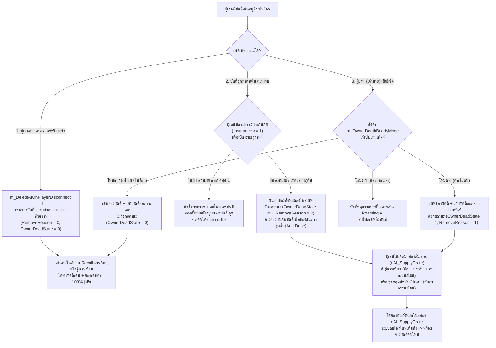

# บทที่ 5: ตารางจำลองสถานการณ์การตายและการกู้คืน (Death, Insurance & Recovery Matrix)

> **[⬅️ บทที่ 4: คู่มือตั้งค่า DLC เสริมทั้งหมด](./04-DLC-Gravedigger-Radio-Medic-HUD-Economy.md)** | **[➡️ บทที่ 6: ระบบ Faction, พันธมิตร และการวางพิกัด NPC](./06-Factions-Coordinates-and-Editor-Guide.md)**

เพื่อให้แอดมินเข้าใจอย่างทะลุปรุโปร่งว่า **เมื่อเกิดการตายขึ้นในเกม ตัวบัดดี้ ศพของบัดดี้ และสัมภาระในกระเป๋าจะเป็นอย่างไร** บทนี้ได้สรุปทุกเงื่อนไขออกมาเป็นตารางเปรียบเทียบแบบชัดเจนครับ

---

## 1. แผนภาพวงจรชีวิตและการกู้คืน (Death & Recovery Flowchart)

---

## 2. ตารางเปรียบเทียบกรณีที่ 1: เมื่อ **บัดดี้ (Companion AI)** ถูกฆ่าตาย

| การตั้งค่า `m_EnableRecoverySystem` | จำนวนประกันภัยดิจิทัลของผู้เล่น (`InsuranceCount`) | มีโมดูลสัปเหร่อ (`Gravedigger`) หรือไม่? | สิ่งที่เกิดขึ้นกับศพบัดดี้ในจุดตาย | สิ่งที่เกิดขึ้นกับไฟล์เซฟและวิธีได้ของคืน |
| :---: | :---: | :---: | :--- | :--- |
| **`1` (เปิด)** | **มีประกัน (`>= 1` ฉบับ)** | มีหรือไม่มีก็ได้ | ระบบบันทึกของทั้งหมดเข้าเซฟและ **ลบของบนศพออกทันที** (ป้องกันคนลูทศพแล้วเจ้าของไปกดเคลมซ้ำ = กัน Dupe 100%) | • ไฟล์เซฟถูกล็อก (`OwnerDeadState = 1, RemoveReason = 2`) • ผู้เล่นเดินไปที่ **ตู้ดาวเทียม** กดเคลมรับของทั้งหมดคืนเป็นกล่อง **`eAI_SupplyCrate`** (หักประกัน 1 ฉบับ + ค่าธรรมเนียมกู้คืน) • หรือไปยืมพลั่ว **ขุดหลุมศพกับสัปเหร่อ** เพื่อรับกล่อง `eAI_SupplyCrate` ก็ได้ |
| **`1` (เปิด)** | **ไม่มีประกัน (`0` ฉบับ)** | **ไม่ได้ลง `Gravedigger`** | **ของทั้งหมดยังคงอยู่บนศพบัดดี้ตามธรรมชาติ** ผู้เล่นหรือคนอื่นสามารถเดินไปเปิดศพลูทของออกมาได้เลย | • **ลบไฟล์เซฟทิ้งทันที (บัดดี้ตายถาวร)** • ไม่สามารถไปซื้อประกันย้อนหลังเพื่อเคลมตอนบัดดี้ตายไปแล้วได้ (ต้องซื้อประกัน **ก่อน** บัดดี้ตายเท่านั้น!) |
| **`1` หรือ `0`** | **ไม่มีประกัน (`0` ฉบับ)** | **เปิดใช้งาน `Gravedigger`** | ระบบนำของบัดดี้ไปเก็บรอที่สุสานและล้างของบนศพ (กัน Dupe) | • ผู้เล่นไม่สามารถเคลมผ่านตู้ดาวเทียมได้ (เพราะไม่มีประกันดิจิทัล) • แต่ผู้เล่นสามารถเดินทางไปที่ **สุสานสัปเหร่อ** ยืมพลั่วแล้ว **ขุดหลุมศพ (`DZS_BuddyGrave`)** เพื่อนำของบัดดี้คืนมาเป็นกล่อง `eAI_SupplyCrate` ได้! |

---

## 3. ตารางเปรียบเทียบกรณีที่ 2: เมื่อ **ผู้เล่น (เจ้านาย)** เสียชีวิต (แต่บัดดี้ยังไม่ตาย)

ผลลัพธ์ขึ้นอยู่กับตัวแปร **`m_OwnerDeathBuddyMode`** ใน `BuddySettings.json`:

| ค่า `m_OwnerDeathBuddyMode` | ชื่อโหมด | สิ่งที่เกิดขึ้นกับตัวบัดดี้ทันทีที่ผู้เล่นตาย | เมื่อผู้เล่นเกิดใหม่ (Respawn) ต้องทำอย่างไร? | เหมาะกับเซิร์ฟเวอร์แนวไหน? |
| :---: | :--- | :--- | :--- | :--- |
| **`0`** *(ค่าเริ่มต้น)* | **Satellite / Cemetery Lock** (ล็อกเข้าระบบกู้คืน) | บัดดี้ถูกบันทึกของในตัวทั้งหมดและ **หายตัวออกจากโลกทันที** สถานะไฟล์เซฟถูกล็อก (`OwnerDeadState = 1, RemoveReason = 1`) ไม่สามารถกดวิทยุ Recall ออกมาได้ | • **วิธีที่ 1 (ตู้ดาวเทียม):** ไปที่ตู้ดาวเทียม (หากยังไม่มีประกัน สามารถกดซื้อประกันที่ตู้ตอนนั้นได้เลย!) แล้วกดปุ่มเคลมเพื่อรับของบัดดี้ทั้งหมดคืนเป็นกล่อง **`eAI_SupplyCrate`** • **วิธีที่ 2 (สุสานสัปเหร่อ):** ไปยืมพลั่วขุดหลุมศพเพื่อรับกล่อง **`eAI_SupplyCrate`** • *(หากไม่ต้องการของเดิมและไปกดจ้างบัดดี้คนใหม่เลย จะมีหน้าต่างแจ้งเตือน `UNRECOVERED COMPANION GEAR` ถามยืนยันก่อนลบของเก่า)* | **PvPvE / Tactical Survival** (มีบทลงโทษเมื่อตาย ต้องเสียค่าเคลมของและต้องจ้างบัดดี้ใหม่ แต่ของที่ฝากบัดดี้ไว้ไม่หายฟรี) |
| **`1`** | **Release as Roaming AI** (ปล่อยเป็น AI พเนจรทันที) | บัดดี้จะถูกปลดออกจากกลุ่มของผู้เล่น กลายเป็น AI อิสระ (`eAIFactionRoamingBuddy`) ยืนอยู่ในจุดเดิมในโลก และ **ลบไฟล์เซฟทิ้งทันที** | • ไม่สามารถกู้คืนจากตู้ดาวเทียมหรือสุสานได้ • หากผู้เล่นวิ่งกลับไปที่ศพตัวเองทันก่อนครบเวลา `m_AutoCleanDismissedTime` (15 นาที) อาจเจอบัดดี้ยืนอยู่แถวนั้น หรือต้องไปจ้างบัดดี้คนใหม่ที่ NPC Contractor | **Hardcore Survival** (ตายแล้วเสียสัญญาจ้างบัดดี้ทันที) |
| **`2`** | **Safe Despawn & Recallable** (เก็บเซฟและเรียกกลับมาเดินต่อได้เลย) | บัดดี้ถูกบันทึกของในตัวทั้งหมดและ **หายตัวออกจากโลกอย่างปลอดภัย** โดย **ไม่ล็อกสถานะ** (`OwnerDeadState = 0, RemoveReason = 0`) | • ผู้เล่นเกิดใหม่แล้วไปที่ **ตู้ดาวเทียม** (หรือใช้วิทยุที่ Pair แล้ว) กด **`RECALL BUDDY`** • **ได้ทั้งตัวบัดดี้คนเดิมและอุปกรณ์ทุกชิ้นกลับมาเดินด้วยกันต่อทันที!** โดยไม่ต้องเคลมเป็นกล่องและไม่ต้องจ้างบัดดี้ใหม่ | **PvE Casual / Solo-Friendly** (ผู้เล่นตายแล้วบัดดี้ไม่หาย เรียกออกมาลุยต่อได้ง่าย) |

---

## 4. เปรียบเทียบการกู้คืน 2 ช่องทาง: ตู้ดาวเทียม (Satellite) vs สุสานสัปเหร่อ (Gravedigger)

แอดมินสามารถเลือกเปิดใช้ **อย่างใดอย่างหนึ่ง** หรือ **เปิดคู่กันทั้งสองระบบ** ก็ได้:

| หัวข้อเปรียบเทียบ | 📡 ตู้ดาวเทียม (`DayZStory_Buddy_Satellite`) | ⚰️ สุสานสัปเหร่อ (`DayZStory_Buddy_Gravedigger`) |
| :--- | :--- | :--- |
| **ธีมและบรรยากาศ** | ทันสมัย / Military Sci-Fi / ตู้สื่อสารในเซฟโซนหรือค่ายทหาร | ดิบเถื่อน / Immersive Survival / สุสานโบสถ์พร้อมสัปเหร่อเฝ้าสุสาน |
| **ต้องใช้กรมธรรม์ประกันภัย (`Insurance`) หรือไม่?** | **จำเป็นต้องมีประกัน (`>= 1` ฉบับ)** *(กรณีบัดดี้ตายต้องซื้อประกันไว้ก่อนตาย / กรณีผู้เล่นตายสามารถมาซื้อประกันที่ตู้ก่อนกดเคลมได้)* | **ไม่ต้องใช้ประกันภัยดิจิทัล** เพียงเดินทางมาที่สุสาน จ่ายค่ายืมพลั่ว (`ShovelBorrowCost`) และค่าธรรมเนียมขุด (`RecoveryReputationCost`) |
| **ขั้นตอนการรับของคืน** | เปิดหน้าต่าง UI ที่ตู้ดาวเทียม -> เข้าเมนู `BUDDY INSURANCE POLICY` -> กดปุ่มเคลม -> กล่อง `eAI_SupplyCrate` เกิดข้างตู้ทันที | คุยกับ NPC สัปเหร่อเพื่อยืมพลั่ว `DZS_GravediggerShovel` -> เดินไปที่หลุมศพ `DZS_BuddyGrave` -> กดขุดค้างไว้ 6 วินาที -> กล่อง `eAI_SupplyCrate` เกิดบนหลุมศพ |
| **ความเป็นส่วนตัวของกล่อง (`eAI_SupplyCrate`)** | กล่องถูกผูกกับ SteamID ของเจ้าของ และสามารถใช้ไขควง/ชะแลงรื้อกล่องทิ้งเมื่อหยิบของเสร็จได้ | กล่อง `eAI_SupplyCrate` แบบเดียวกันเป๊ะ ปลอดภัยและลบไฟล์เซฟทันทีหลังขุดเสร็จเพื่อป้องกันการขุดซ้ำ |
